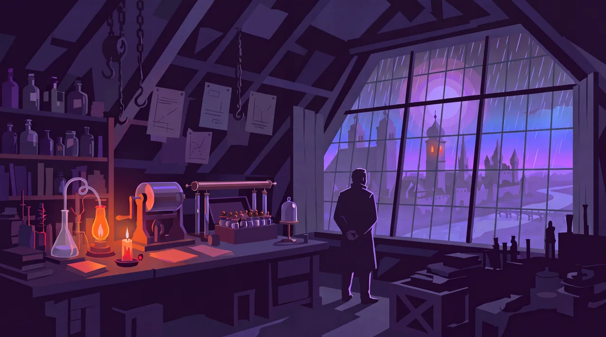
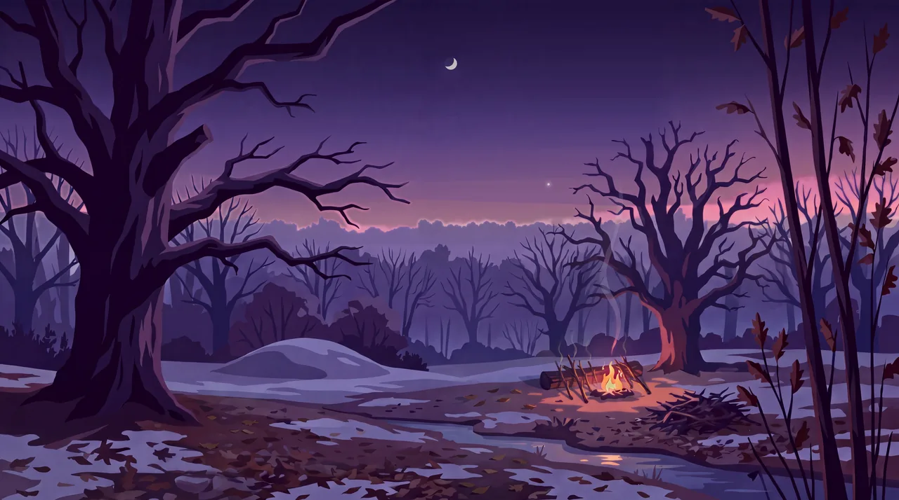
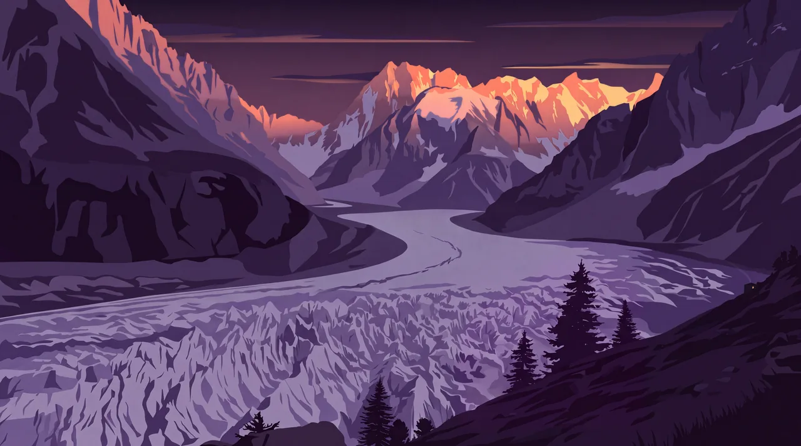
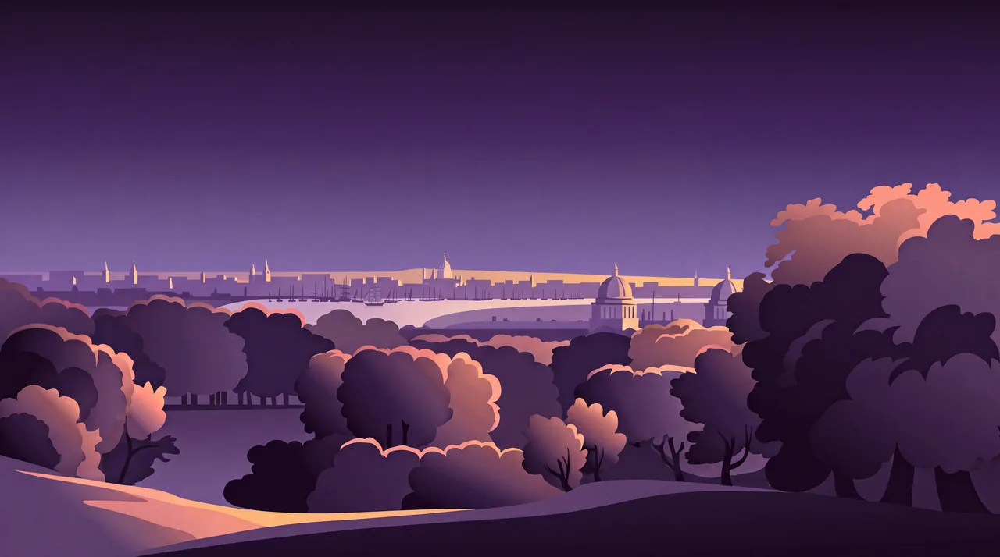
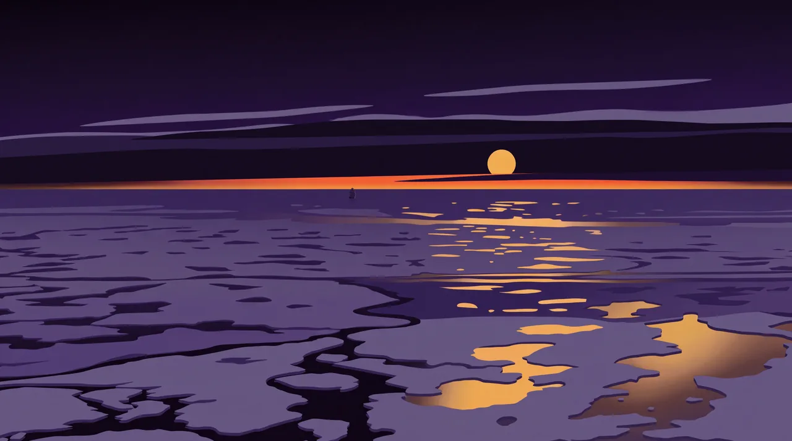
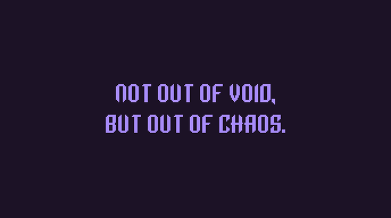

# Ingolstadt 1792


> Ingolstadt, November 1792. One in the morning. Rain on the attic panes, the candle nearly burnt out. Victor Frankenstein has built everything he can. All that's left is a spark of being. AI and Omarchy put the laboratory in our hands. So build. Experiment.

An Omarchy theme from Mary Shelley's *Frankenstein*, in plum night, moonlit lavender and candle amber, sampled from the attic painting.

## Backgrounds

Numbered in the order the story happens. Click a picture for the full 5504×3072 wallpaper.

[](backgrounds/1-ingolstadt-1792.webp)

**1 · Ingolstadt, 1792.** November, one in the morning, the night Victor brings his creation to life. By its own account it wakes "benevolent and good". The tragedy is that Victor runs from it. With AI, every builder stands in this room now. Don't run. Build.

[](backgrounds/2-the-fire-1792.webp)

**2 · The Fire, 1792.** Winter, a few weeks after the creature woke, in "the forest near Ingolstadt". He found a fire left by "wandering beggars", burnt his hand in it, and wondered "that the same cause should produce such opposite effects". He didn't walk away. He dried wet branches by the heat, kept it alive through the night, and found "that the fire gave light as well as heat". AI is learned the same way: by working with it every day. Build.

[](backgrounds/3-montanvert-1794.webp)

**3 · Montanvert, 1794.** August, sunset over the Mer de Glace, the "sea of ice" that gave Victor "a sublime ecstasy, that gave wings to the soul". In the hut on the mountain, Victor hears his creation out and says yes: "I consent". The creature's answer: "Depart to your home, and commence your labours". Plenty of people are still deciding whether to say yes to AI. The yes is the easy part. Then the labours begin. Build.

[](backgrounds/4-london-1794.webp)

**4 · London, 1794.** A clear autumn morning over the Thames at Greenwich. Victor and Clerval sail upriver, and "at length we saw the numerous steeples of London, St. Paul's towering above all". Victor has come for "the most distinguished natural philosophers"; Clerval for "the men of genius and talent who flourished at this time". The best minds used to be a voyage away. With AI, they work beside you. Build.

[](backgrounds/5-midnight-sun-1797.webp)

**5 · Midnight Sun, 1797.** July, "a very high latitude", where "the sun is for ever visible". Robert Walton sails north through the drifting ice toward the pole, on the voyage that frames the whole novel. He writes home: "Success shall crown my endeavours." And: "What can stop the determined heart and resolved will of man?" With AI, nothing. Build.

<table><tr>
<td width="33%"><a href="backgrounds/6-out-of-chaos.webp"></a></td>
<td width="33%"><a href="backgrounds/7-omarchy.webp"></a></td>
<td width="33%"><a href="backgrounds/8-omarchy-logo.webp"></a></td>
</tr></table>

**6 · Out of chaos.** Mary Shelley, 1831: invention "does not consist in creating out of void, but out of chaos". AI is the same: something new, made from everything we've already made.

**7 · Omarchy** and **8 · The symbol.** The Omarchy wordmark and logo in the theme's colours, drawn from the official pixel grid.

## Background intros

Backgrounds 1 to 6 each open with a six-second intro that ends on the still. Intros are in Omarchy's development branch; once they ship in a release, they'll play at login and when you switch to the theme.

The attic opens with rain running down the panes while the candle and lamp settle.

https://github.com/user-attachments/assets/18b51d0a-7c6f-434c-a013-22a3a826f752

The Fire opens at night on the beggars' embers: the wet branches dry and catch, and the fire gives light as well as heat.

https://github.com/user-attachments/assets/5865c822-cb63-42ab-ba6d-ac659d6ecf15

Montanvert is the evening the creature leaves, when "the sun was upon the verge of the horizon": the peaks deepen into alpenglow, the glacier sinks into dusk, and smoke rises from the hut.

https://github.com/user-attachments/assets/d028cb9f-50c5-4ad4-87d4-1f28e8f767d9

London arrives "on a clear morning": the low sun reaches the steeples, the domes and the treetops first, and warms the city out of the dawn shade.

https://github.com/user-attachments/assets/d4a6501b-2172-4e7f-8af4-e0058ba79fd4

Midnight Sun acts out Walton's "the sun is for ever visible; its broad disk just skirting the horizon": the sun never leaves the sky, it burns from deep red to gold, and the gold comes back across the water and the ice.

https://github.com/user-attachments/assets/0d907681-052a-4ef9-8695-f4b4e0de1b50

Out of chaos acts out its quote: the first line surfaces from the dark, then the second is built from single bits flying in from every direction, and the words are given a spark of being.

https://github.com/user-attachments/assets/9702e1e7-795a-45de-90c6-19028647c77b

## Install

```bash
omarchy-theme-install https://github.com/nathankramm/omarchy-ingolstadt-1792-theme
```

Or Omarchy menu → Install → Style → Theme, then paste the same URL. Works on Omarchy 3.4 or later, including Omarchy 4.

Already installed? Run `omarchy-theme-update`, then pick Ingolstadt 1792 again under Style → Theme to load the newest pictures and intros.

**Boot screen.** Choose Ingolstadt 1792 under Style → Unlock for the OMARCHY wordmark in candle gold (Omarchy 3.7 or later).


**Screensaver.** *OMARCHY; or, The Modern Prometheus*, after the 1818 title page, drawn in the Omarchy logo font.

https://github.com/user-attachments/assets/1fd71c8f-09b5-46fa-989f-c32b4382386a

It's optional. To use it:

```bash
cp ~/.config/omarchy/themes/ingolstadt-1792/branding/screensaver.txt ~/.config/omarchy/branding/screensaver.txt
```

It uses newer block characters that Foot (Omarchy's default), Ghostty and Kitty draw. On Alacritty, copy `screensaver-classic.txt` instead. Style → Screensaver → Restore Default brings back the Omarchy logo.

## Palette

| Role | Hex |
| --- | --- |
| Background | `#1c1226` |
| Dark background | `#160e1e` |
| Darker background | `#100a16` |
| Lighter background | `#2a1d3a` |
| Foreground | `#cbbfe8` |
| Accent | `#a78bfa` |
| Selection | `#3a2856` |
| Muted | `#584a7c` |
| Candle amber | `#f0b45e` |

Full palette in [`colors.toml`](colors.toml). Icons are `Yaru-purple`; Chrome gets near-stock greys (`#161518`).

## Credit

The five scenes are AI-generated (Grok Imagine, Nano Banana Pro), directed by Nathan Kramm. 6, 7 and 8 are drawn in code, and so is the screensaver. The intros are animated in code from the pictures.

Every quotation is Mary Shelley's own: the 1818 novel, her 1831 revision and her 1831 introduction. The novel dates its letters only "17—", so the years are reconstructed from the story.

Midnight Sun is painted over a public-domain NOAA photograph (NOAA Photo Library, pl23arct0259, Beaufort Sea, 2008).

Montanvert is painted over a public-domain photograph of the Mer de Glace from Montanvert, 1863–65 (Rijksmuseum, RP-F-F80196).

London is painted over a public-domain watercolour, *The Thames at Greenwich*, after John Robert Cozens (composition 1792; Victoria and Albert Museum, P.28-1934).

*"And now, once again, I bid my hideous progeny go forth and prosper."* — Mary Shelley, 1831
