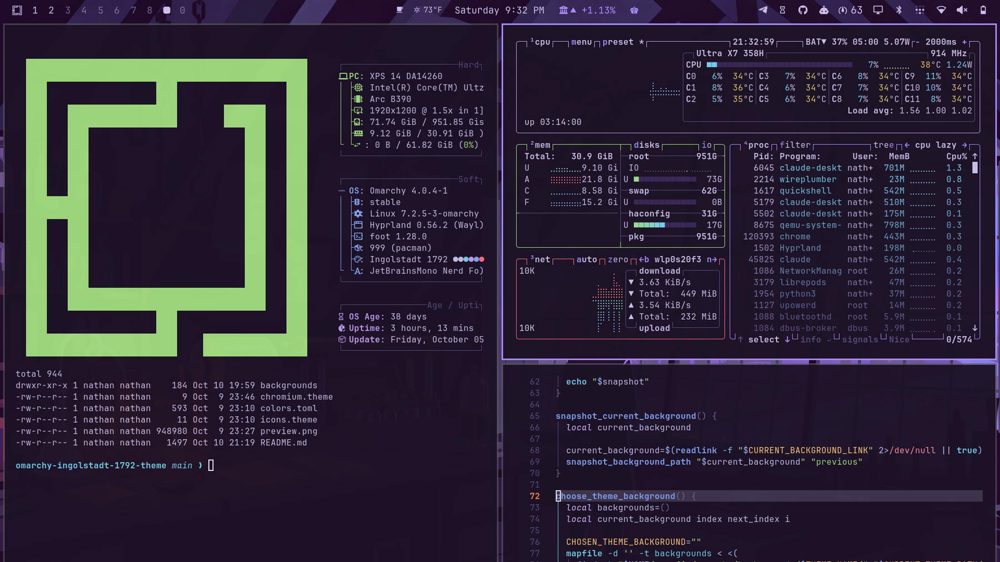

# Ingolstadt 1792



> Ingolstadt, November 1792. One in the morning. Rain on the attic panes, the candle nearly burnt out. Victor Frankenstein has built everything he can. All that's left is a spark of being. AI and Omarchy put the laboratory in our hands. So build. Experiment.

An Omarchy theme in plum night, moonlit lavender and candle amber, sampled from the painting.

## Backgrounds

Numbered in the order the story happens. 2 is still being made.

**1 · Ingolstadt, 1792.** November, one in the morning. Moments before the creature opens its eye. It will wake up good; whether Victor stays or runs is still his to choose. Every time we build something now, we stand in this room.

**3 · Montanvert, 1794.** August, sunset over the Mer de Glace, the "sea of ice" that gave Victor "a sublime ecstasy that gave wings to the soul". In the hut on the mountain, by the creature's fire, Victor has heard his creation out and says yes: "I consent." The creature's answer: "Depart to your home and commence your labours." Find him on the ice, and the light in the hut. Then build.

**4 · London, 1794.** A clear autumn morning, from Greenwich Park. Victor and Clerval sail up the Thames past Greenwich, and "at length we saw the numerous steeples of London, St. Paul's towering above all." Victor has come for "the most distinguished natural philosophers"; Clerval for "the men of genius and talent who flourished at this time." Find their ship on the river. The best minds used to be a voyage away. With AI, they're a question away. Learn, then build.

**5 · Midnight Sun, 1797.** July, "a very high latitude", where "the sun is for ever visible". Robert Walton drives north through the drifting ice toward the pole, the voyage that frames the whole novel. "Success shall crown my endeavours." "What can stop the determined heart and resolved will of man?" With AI, nothing. Build.

**6 · Out of chaos.** Mary Shelley, 1831: invention "does not consist in creating out of void, but out of chaos." AI is the same: something new, made from everything we've already made.

**7 · Omarchy** and **8 · The symbol.** The Omarchy wordmark and logo in the theme's colours, drawn from the official pixel grid.

## Install

Omarchy menu → Install → Style → Theme, then paste:

```
https://github.com/nathankramm/omarchy-ingolstadt-1792-theme
```

**Boot screen.** Choose Ingolstadt 1792 under Style > Unlock for the OMARCHY wordmark in candle gold.

## Credit

Wallpapers are AI-generated (Grok Imagine, Nano Banana Pro), directed by Nathan Kramm.

Midnight Sun is painted over a public-domain NOAA photograph (NOAA Photo Library, pl23arct0259, Beaufort Sea, 2008).

Montanvert is painted over a public-domain photograph of the Mer de Glace from Montanvert, 1863–65 (Rijksmuseum, RP-F-F80196).

London is painted over a public-domain watercolour, *The Thames at Greenwich*, after John Robert Cozens (composition 1792; Victoria and Albert Museum, P.28-1934).

*"And now, once again, I bid my hideous progeny go forth and prosper."* — Mary Shelley, 1831
